# カレンダーアプリ 機能詳細

https://calendar-dsr.pages.dev/

画面にあるボタン、表示、入力項目の意味を調べるための説明です。予定案を作って採用するまでの流れは、別冊の[操作ガイド](USER_GUIDE.md)を参照してください。

画像は実際のアプリ画面です。**青い枠・番号・右側の説明欄は、この文書のために加えた注釈**です。番号は画像ごとに振り直しています。画面の予定や数値は説明用の例です。

## 目次

- [1. カレンダーとメニュー](#1-カレンダーとメニュー)
- [2. 背景色・負荷率・日付の見方](#2-背景色負荷率日付の見方)
- [3. シーンの管理](#3-シーンの管理)
- [4. 日別詳細とシーンの比較](#4-日別詳細とシーンの比較)
- [5. 一覧と検索](#5-一覧と検索)
- [6. タスクの追加・編集](#6-タスクの追加編集)
- [7. プロジェクトと終日予定](#7-プロジェクトと終日予定)
- [8. 最適化と取り消し](#8-最適化と取り消し)
- [9. 設定](#9-設定)
- [10. 保存とデータ管理](#10-保存とデータ管理)
- [11. 確認・警告・エラー](#11-確認警告エラー)

## 1. カレンダーとメニュー

### 1.1 画面全体

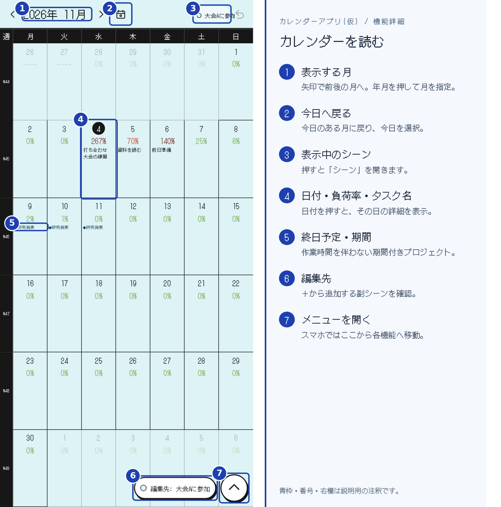

| 番号 | 表示・ボタン | 意味・押したときの動作 |
|---|---|---|
| 1 | 表示月 | 左右の矢印で前月・翌月へ移動します。年月の部分を押すと、表示する月を指定できます。 |
| 2 | 今日へ戻る | カレンダーのアイコンです。今日がある月へ戻り、今日を選択します。 |
| 3 | 表示中のシーン | 現在カレンダーに表示している予定案です。押すとシーン画面が開きます。 |
| 4 | 日付セル | その日の負荷率とタスク名を表示します。押すと日別詳細が開きます。 |
| 5 | 終日予定・期間 | 期間付きプロジェクトを表示します。作業時間や負荷を発生させる表示ではありません。 |
| 6 | 編集先 | 「＋」からタスクを追加する副シーンです。押すとシーン画面で編集先を変更できます。 |
| 7 | メニューを開く | スマートフォンで各機能のボタンを表示します。開いた後は「×」でメニューを閉じます。 |

画面右上の折り返した矢印は[Undo](#82-undo取り消し)です。月を移動する矢印とは働きが異なります。

### 1.2 メニューの各ボタン

スマートフォンのメニューは**上から次の順番**です。PCでは同じボタンが常時表示されます。

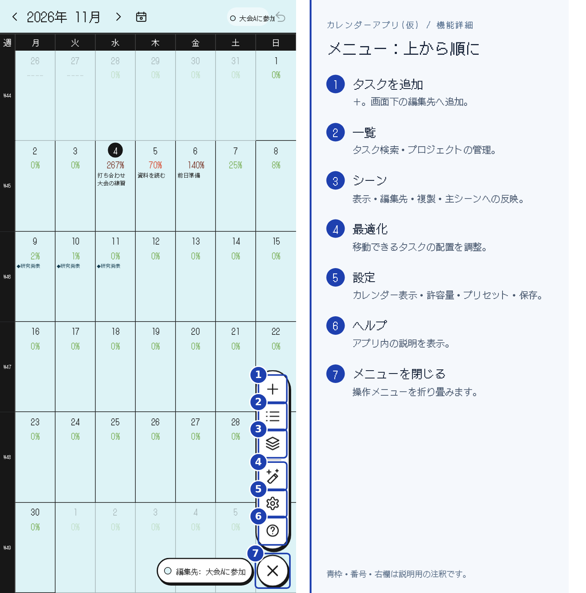

| 番号 | アイコン・名前 | 開く画面・できること |
|---|---|---|
| 1 | ＋：タスクを追加 | 編集先の副シーンにタスクを追加します。副シーンがまだない場合は、名前を入力して主シーンのコピーを作成した後、タスク追加画面を開きます。 |
| 2 | リスト：一覧 | シーン内のタスク検索、タスク・プロジェクトの追加と編集を行います。 |
| 3 | 重なった図形：シーン | 表示するシーン、編集先、複製、名前変更、主シーンへの反映、削除を扱います。 |
| 4 | 魔法の杖：最適化 | 選んだシーンの、移動できるタスクを再配置します。 |
| 5 | 歯車：設定 | カレンダー表示、曜日ごとの許容量、負荷プリセット、保存関連の設定を開きます。 |
| 6 | ？：ヘルプ | アプリ内の操作説明を開きます。 |
| 7 | ×：メニューを閉じる | メニューだけを折り畳みます。 |

### 1.3 月・週の移動と画面を閉じる操作

- 月間カレンダーでは、左または上へのスワイプで翌月、右または下へのスワイプで前月へ移動できます。
- スマートフォンで日別詳細・一覧・設定などを開くと、上側には選択日を含む1週間を残します。上の週を左右にスワイプすると1週ずつ移動できます。「今日へ戻る」でも下の画面は閉じません。
- 2本指を広げたり狭めたりすると拡大・縮小できます。拡大中は1本指で表示位置を動かせます。月・週のスワイプ移動は、元の倍率へ戻すと再開します。
- 下から開く画面は「×」で閉じます。カレンダー側の画面外部分をタップしても閉じられます。そのタップで背後の日付を選択することはありません。
- タスク・プロジェクトの編集は、左上の「戻る」で終了します。編集内容が変わっていれば破棄確認が出ます。
- 上書き・削除などの確認ダイアログは、内容を読んでボタンを選びます。画面外のタップで確定することはありません。

## 2. 背景色・負荷率・日付の見方

### 2.1 背景色はシーン、負荷率の文字色は負荷の大きさ

**水色や黄色などの背景は「どのシーンか」を示します。負荷の強弱を示す色ではありません。** シーン名の横の丸、シーン一覧の行、編集画面にも対応する色を使います。主シーンは白、副シーンは水色・黄色・淡い橙色・紫色の順に割り当てられます。

負荷の強弱を表すのは、日付にある**パーセントの文字色**です。

| 負荷率の文字色 | 意味 |
|---|---|
| 緑 | 総合負荷が30%未満。 |
| 黄 | 総合負荷が30%以上70%未満。 |
| 赤 | 総合負荷が70%以上。 |
| 濃い赤褐色 | 総合負荷、または時間・身体・精神・認知のいずれかが100%を超えています。 |
| 灰色の `----` | 未計算です。0%という意味ではありません。 |

計算対象は**本日から3か月後まで**です。期間外の負荷は `----` になりますが、登録されたタスクやプロジェクト期間は表示できます。表示値は整数に丸めます。色は丸める前の値で決まるため、境界付近では見た目の数値だけから予想した色と異なる場合があります。

### 2.2 日付とタスク名

| 表示 | 意味 |
|---|---|
| 日付の丸い枠 | 今日です。 |
| 黒い背景に白い日付 | 選択中の日です。今日を選んでいる場合は、今日の表示と重なります。 |
| 薄い日付 | 表示月の前月・翌月に属する日です。 |
| `W45` など | ISO方式の週番号です。設定で非表示にできます。 |
| 日付の下のタスク名 | その日の作業の一部です。単シーンでは最大2件、スマートフォンの比較表示では各シーン最大1件を表示します。優先度の高いものから表示します。すべてを見るには日別詳細を開きます。 |
| `◆` に続く名前 | 終日予定・期間として表示しているプロジェクトです。 |

### 2.3 負荷率は何を基準にしているか

タスクの「負荷」は**その作業を1時間行ったときの消耗量**、設定の「許容量」は**その曜日の1日分の目安**です。

たとえば認知負荷が20pt/時間の作業を2時間行うと、その日の認知の消耗量は40ptです。その曜日の認知の上限が100ptなら、当日分は40%になります。作業時間も同様に、2時間の作業を時間の目安8時間で割ると25%です。

身体・精神・認知には、前日のそれぞれの負荷率の30%が持ち越されます。前日の認知が50%なら翌日に15%を加えます。曜日によって上限を変えても、この持ち越しは前日の**割合**を基準にします。時間負荷には持ち越しません。

日付の大きな数字は4項目をまとめた**総合負荷**です。複数の作業や締め切りまでの余裕なども反映するため、単なる作業時間の割合や4項目の単純平均にはなりません。

## 3. シーンの管理

シーンとは、タスク・配置・プロジェクトをまとめた独立した予定案です。**主シーンは採用中の予定、副シーンは比較・編集する予定案**です。副シーンは最大4件、カレンダーには同時に1〜2件を表示できます。

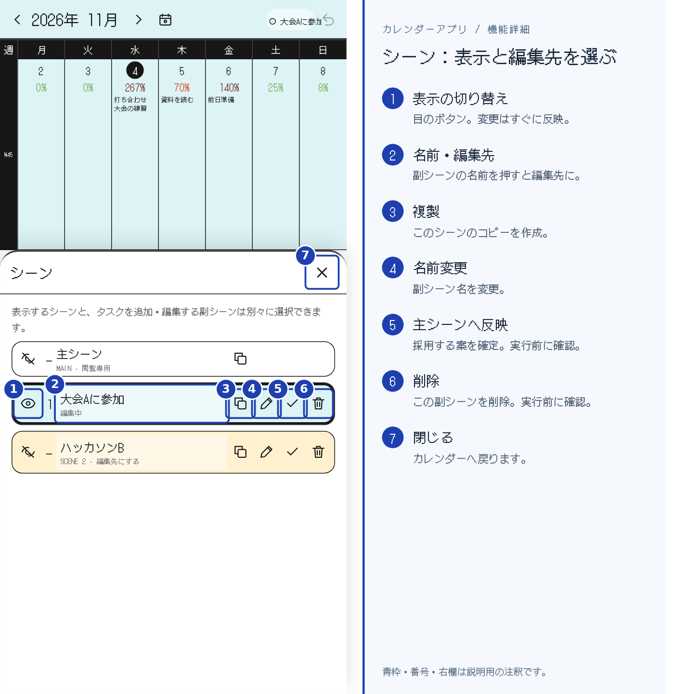

| 番号 | ボタン | 動作 |
|---|---|---|
| 1 | 目／斜線付きの目 | 表示・非表示をその場で切り替えます。行の `1`・`2` は表示順、`–` は非表示です。 |
| 2 | 副シーンの名前 | 押したシーンを編集先にします。太い枠と「編集中」が現在の編集先です。 |
| 3 | 重なった四角：複製 | 選んだシーンのコピーを作ります。名前を入力して確定すると、新しい副シーンのタスク追加画面が開きます。 |
| 4 | 鉛筆：名前変更 | 副シーンの名前を変更します。重複する名前には自動的に番号が付きます。 |
| 5 | チェック：主シーンへ反映 | 採用する副シーンで主シーンを置き換えます。確認後に実行します。 |
| 6 | ごみ箱：削除 | この副シーンを削除します。確認後に実行します。 |
| 7 | ×：閉じる | カレンダーへ戻ります。表示切替を反映する追加のボタン操作は不要です。 |

**表示対象と編集先は別です。** たとえば主シーンと大会Aの案を表示しながら、編集先をハッカソンBの案にすることもできます。「＋」を押す前に、画面下の編集先を確認してください。

表示は最低1件必要です。2件表示中に3件目の目をオンにすると、それまで表示順1だったシーンが外れます。

主シーンは通常のタスク編集で直接変更できません。主シーンの項目を編集する場合は「コピー上で編集」で副シーンを作ります。

**主シーンへ反映すると、その副シーンの内容で主シーンが置き換わり、すべての副シーンが削除されます。** 比較中の案も対象なので、確認画面を読んでから確定してください。

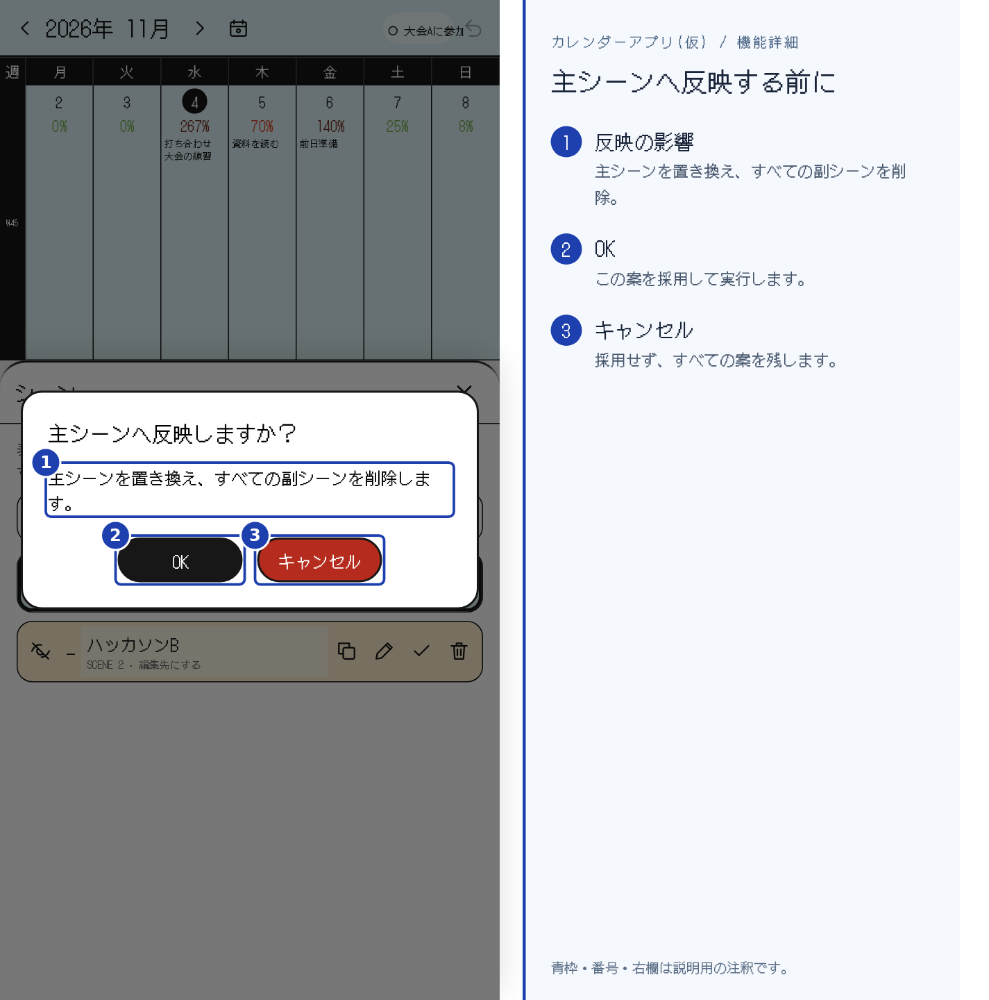

確認画面の②「OK」が反映の実行、③「キャンセル」が中止です。

## 4. 日別詳細とシーンの比較

### 4.1 1シーンの日別詳細

カレンダーの日付を押して開きます。

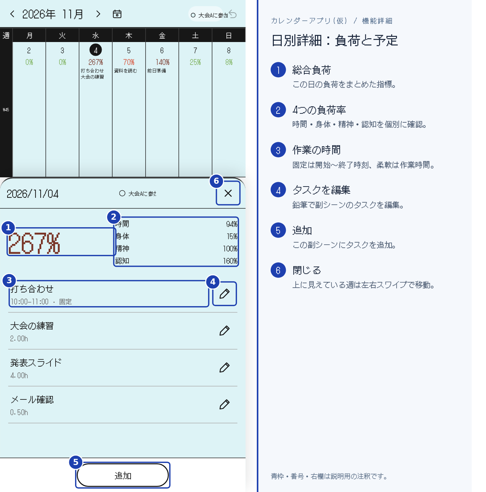

| 番号 | 表示・ボタン | 意味 |
|---|---|---|
| 1 | 総合負荷 | 日付に表示されていた負荷率です。 |
| 2 | 時間・身体・精神・認知 | それぞれの1日分の目安に対する負荷率です。どの項目が高いかを確認できます。 |
| 3 | タスクと時間 | 固定タスクは時刻、柔軟タスクはその日に割り当てた作業時間が分かります。 |
| 4 | 鉛筆／鍵 | 副シーンではタスクを編集します。主シーンの鍵は、コピー上で編集するための入口です。 |
| 5 | 追加 | 副シーンへタスクを追加します。主シーンの場合は「コピー上で編集」になります。 |
| 6 | × | 日別詳細を閉じます。 |

期間付きプロジェクトがある日は、「終日予定・期間」に名前と開始日・終了日を表示します。プロジェクト名の右側から編集できます。

### 4.2 2シーンを表示する

シーン画面で比較したい2件の目をオンにします。

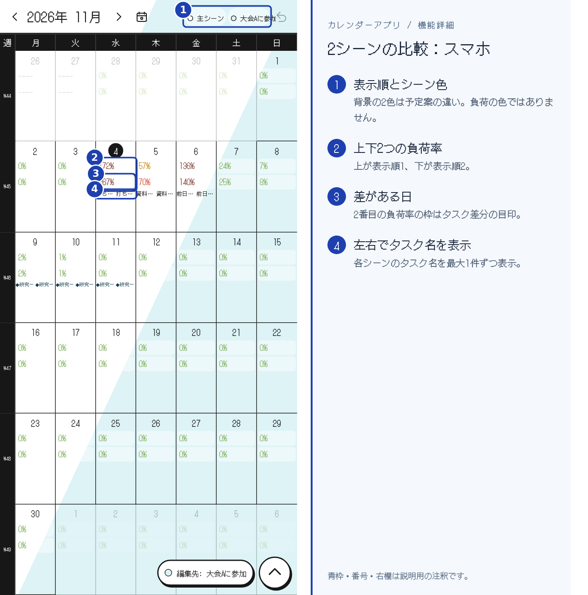

| 番号 | 表示 | 読み方 |
|---|---|---|
| 1 | 2つのシーン名と背景色 | 各予定案を識別する色です。背景は斜めに塗り分けます。 |
| 2 | 上下の負荷率 | 上が表示順1、下が表示順2です。シーン画面の `1`・`2` と対応します。 |
| 3 | 2番目の負荷率の枠 | 2つのシーンで、その日のタスクの内容や配置に差がある印です。 |
| 4 | 左右のタスク名 | 左が表示順1、右が表示順2のタスクです。日付を押すと詳しい差分を確認できます。 |

差分の枠は「数値が大きい方」や「危険な日」を示す枠ではありません。負荷の大小は数字と文字色で判断します。

PCなど幅の広い画面では、2つのカレンダーを左右に並べます。2番目のシーンで差がある日には、日付セルに枠が付きます。

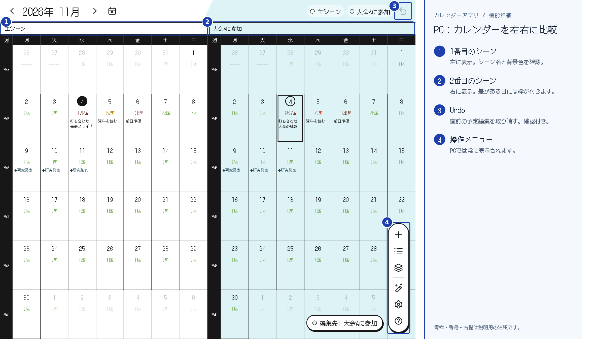

### 4.3 日別の差分表示

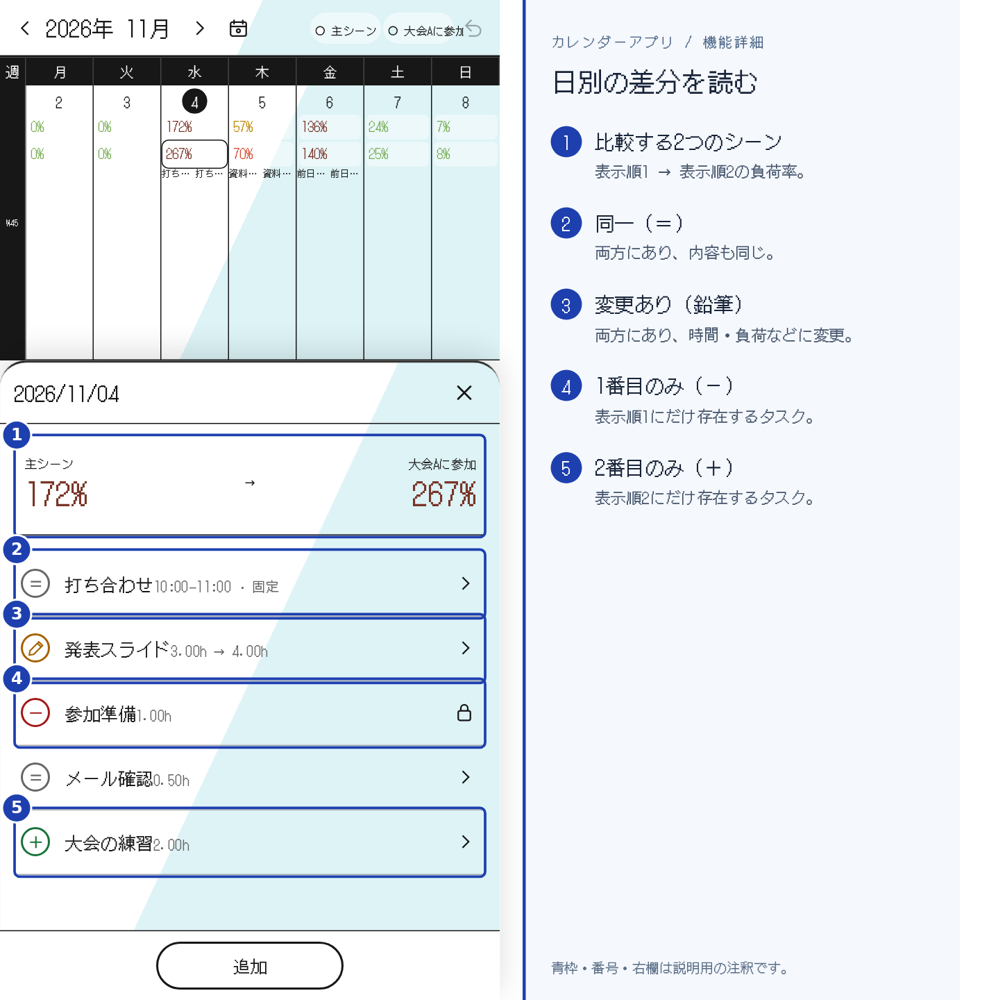

| 番号 | 記号・表示 | 意味 |
|---|---|---|
| 1 | シーン名と `→` | 表示順1から表示順2へ、負荷がどう変わるかを確認します。 |
| 2 | ＝ | 両方にある、内容が同じタスクです。 |
| 3 | 鉛筆 | 両方にありますが、時間・負荷などの内容が変わっています。 |
| 4 | － | 表示順1にのみあるタスクです。 |
| 5 | ＋ | 表示順2にのみあるタスクです。 |

タスクの行を押すと、そのタスクの編集へ進みます。両方にあるタスクでは表示順2が編集対象です。表示順1だけにあるタスクでは表示順1が対象です。対象が主シーンならコピー上で編集します。

`＋`・`－` は比較結果の印です。その場でタスクを追加・削除するボタンではありません。期間付きプロジェクトにも、同じ考え方で差分を表示します。

## 5. 一覧と検索

メニューの「一覧」から開きます。

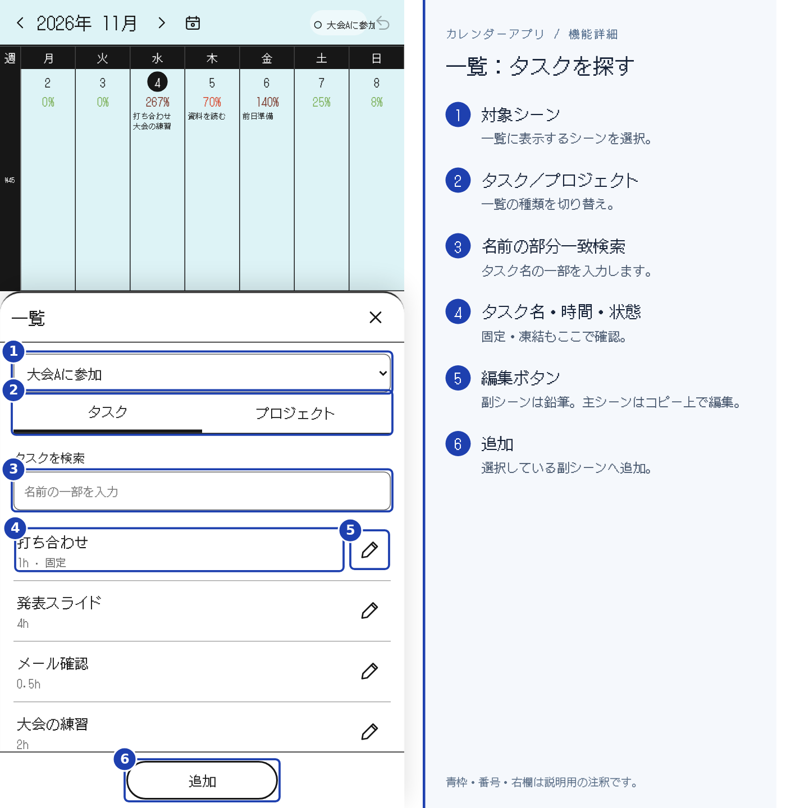

| 番号 | 項目 | 使い方 |
|---|---|---|
| 1 | 対象シーン | 一覧で見るシーンを選びます。副シーンを選ぶと、そのシーンが編集先にもなります。 |
| 2 | タスク／プロジェクト | 一覧の種類を切り替えます。プロジェクトを追加するときも、まずここで切り替えます。 |
| 3 | タスクを検索 | 名前の一部で検索します。たとえば「発表」で「発表スライド」を探せます。説明文や別のシーンは検索対象ではありません。 |
| 4 | タスク情報 | 名前、必要作業時間、固定・凍結の状態を表示します。凍結された項目は薄く表示されます。 |
| 5 | 編集 | 副シーンの鉛筆は直接編集、主シーンの鍵はコピー上で編集します。 |
| 6 | 追加 | 現在の一覧の種類に応じて、タスクまたはプロジェクトを追加します。主シーンならコピーの作成へ進みます。 |

プロジェクト一覧には、プロジェクト名、稼働中／凍結、設定されていれば期間が表示されます。

## 6. タスクの追加・編集

### 6.1 基本項目

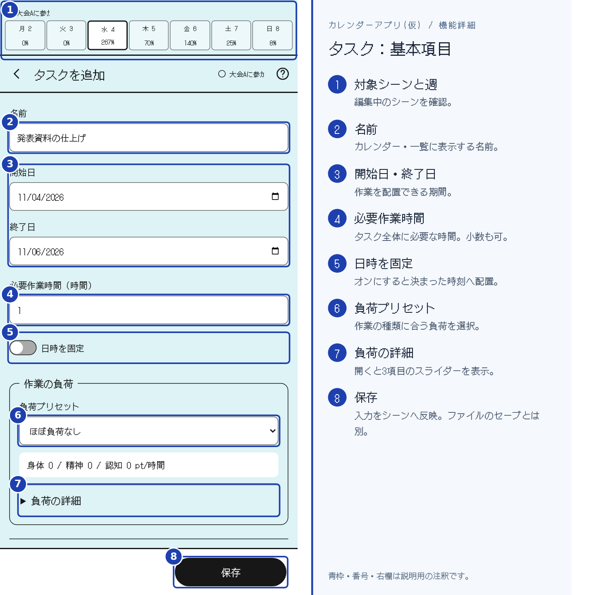

| 番号 | 項目 | 設定する内容 |
|---|---|---|
| 1 | 対象シーンと週 | 現在編集しているシーンと、その週の負荷を確認します。PCでは左、スマートフォンでは上に表示します。 |
| 2 | 名前 | カレンダーや一覧に表示するタスク名です。 |
| 3 | 開始日・終了日 | 作業を配置できる期間です。実際に取り組む時間の長さとは別です。 |
| 4 | 必要作業時間（時間） | タスク全体の作業量です。`1.5` なら1時間30分、`0.25` なら15分です。 |
| 5 | 日時を固定 | 決まった時刻に行う作業でオンにします。固定タスクは最適化で移動しません。 |
| 6 | 負荷プリセット | 作業の種類に合う身体・精神・認知の組み合わせを選びます。 |
| 7 | 負荷の詳細 | 個別に負荷を変えたいときに開きます。新規タスクの初期状態では閉じています。 |
| 8 | 保存 | 入力した内容をシーンに反映します。データ管理の「セーブ」とは別の操作です。 |

柔軟タスクでは開始・終了の時刻を指定せず、各日に何時間取り組むかを扱います。固定タスクは、日付に加えて開始時刻も指定します。

数値欄は編集中に空にできます。空欄のまま別の欄へ移ると0になります。ただし、必要作業時間など0では保存できない項目は、有効な値へ直してください。

### 6.2 負荷プリセットとカスタム

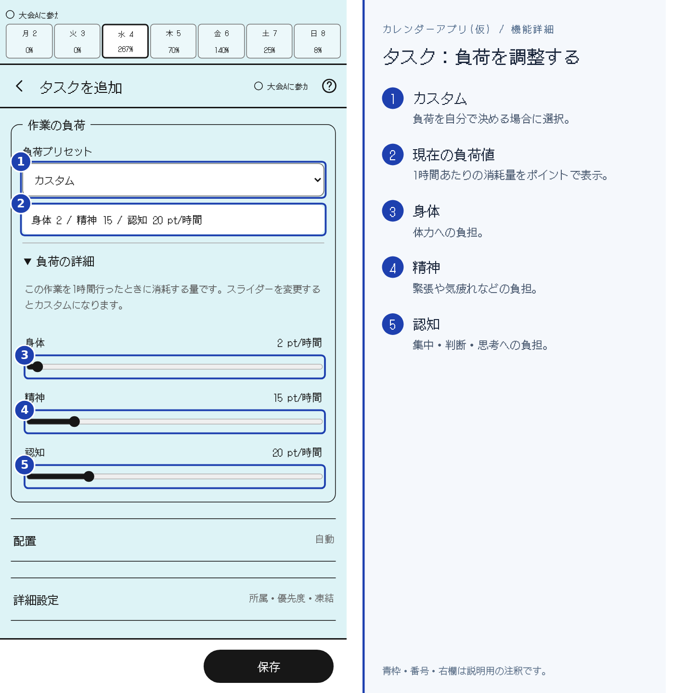

| 番号 | 項目 | 意味 |
|---|---|---|
| 1 | カスタム | 自分で値を設定するときに選びます。選ぶと負荷の詳細が開きます。 |
| 2 | 現在の負荷値 | 現在の身体・精神・認知の値を、詳細を閉じていても確認できます。単位はpt/時間です。 |
| 3 | 身体 | 体力への負担を表す目安です。 |
| 4 | 精神 | 緊張や気疲れなどの負担を表す目安です。 |
| 5 | 認知 | 集中、判断、思考などの負担を表す目安です。 |

スライダーの値を変更するとプリセット指定からカスタムに変わります。プリセットを選び直すと、そのプリセットの3項目で置き換わります。

初期プリセットは「ほぼ負荷なし」「レポート作成」「会議」「事務作業」「集中作業」「調査・学習」「移動・現場作業」です。自分の目安に合わせて[設定から管理](#94-負荷プリセット管理)できます。

**3つの負荷を0にしても、作業時間の負荷は0になりません。** 休みなどで時間を確保したい場合も、作業時間を持つタスクとして登録できます。

### 6.3 配置：自動と手動

「配置」の見出しを押して開きます。

| 配分方法 | 動作 |
|---|---|
| 自動配置 | 開始日から終了日まで、日ごとに必要作業時間を均等に配分します。固定の場合は「共通開始時刻」を指定します。 |
| 手動配置 | 配置する日と作業時間を1行ずつ指定します。固定の場合は行ごとに開始時刻も指定します。 |

この「自動配置」は登録時の均等配分です。負荷を見ながら配置を調整する[最適化](#8-最適化と取り消し)は、メニューから別に実行します。

次の画像は、**日時を固定したタスクを手動配置する場合**です。

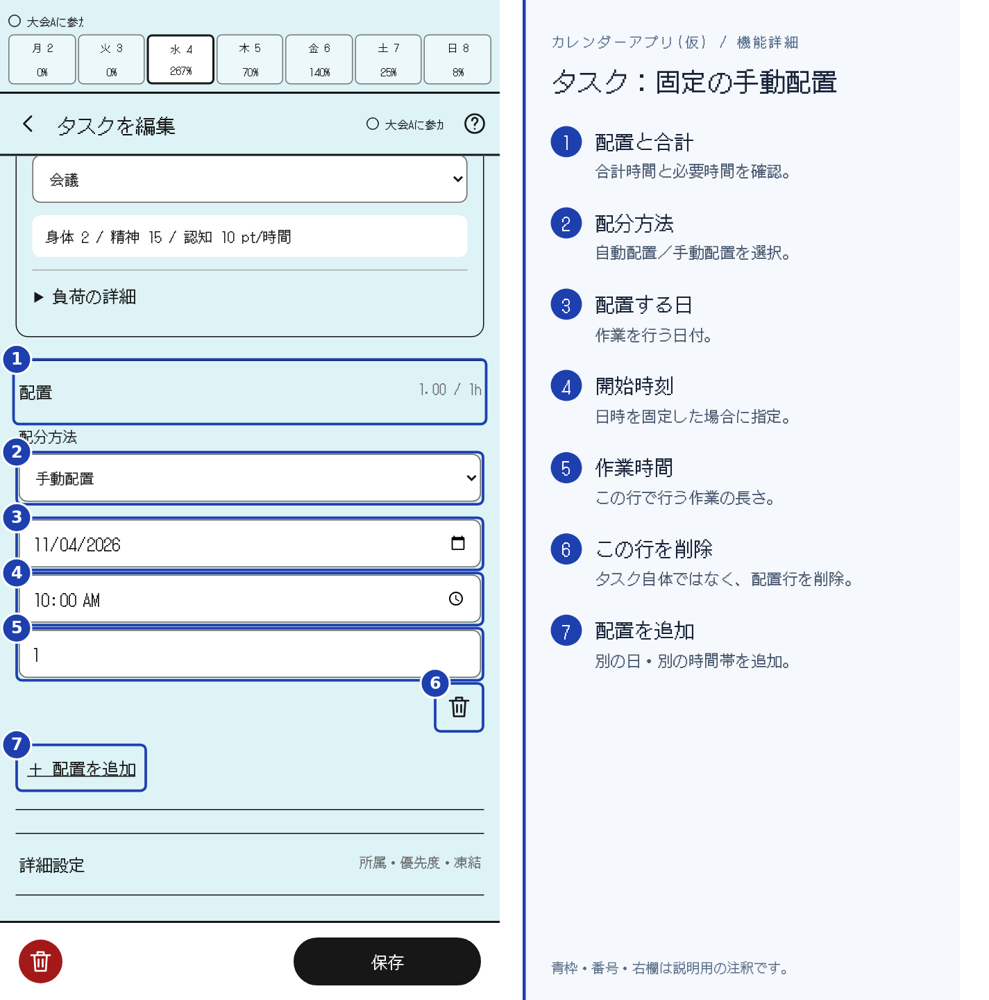

| 番号 | 項目 | 意味 |
|---|---|---|
| 1 | 配置の合計 | 「配置した時間／必要作業時間」を確認できます。 |
| 2 | 配分方法 | 自動配置と手動配置を切り替えます。選択した方法もタスクに保存されます。 |
| 3 | 日付 | その行の作業を行う日です。開始日・終了日の範囲内に設定します。 |
| 4 | 開始時刻 | 固定タスクで表示します。柔軟タスクにはありません。 |
| 5 | 時間 | その行で何時間取り組むかを指定します。小数も使えます。 |
| 6 | 行のごみ箱 | この配置行だけを削除します。タスク自体は残ります。 |
| 7 | ＋ 配置を追加 | 別の日や別の時間帯を追加します。 |

必要作業時間と配置合計を一致させてください。配置可能期間外、同じ固定タスク内での時刻の重複などは修正が必要です。1日の全タスクの配置合計には24時間の上限があります。曜日の作業時間の目安を大きくしても、この上限は変わりません。

### 6.4 詳細設定

「詳細設定」を開くと、所属・優先度・依存関係・凍結・説明を設定できます。

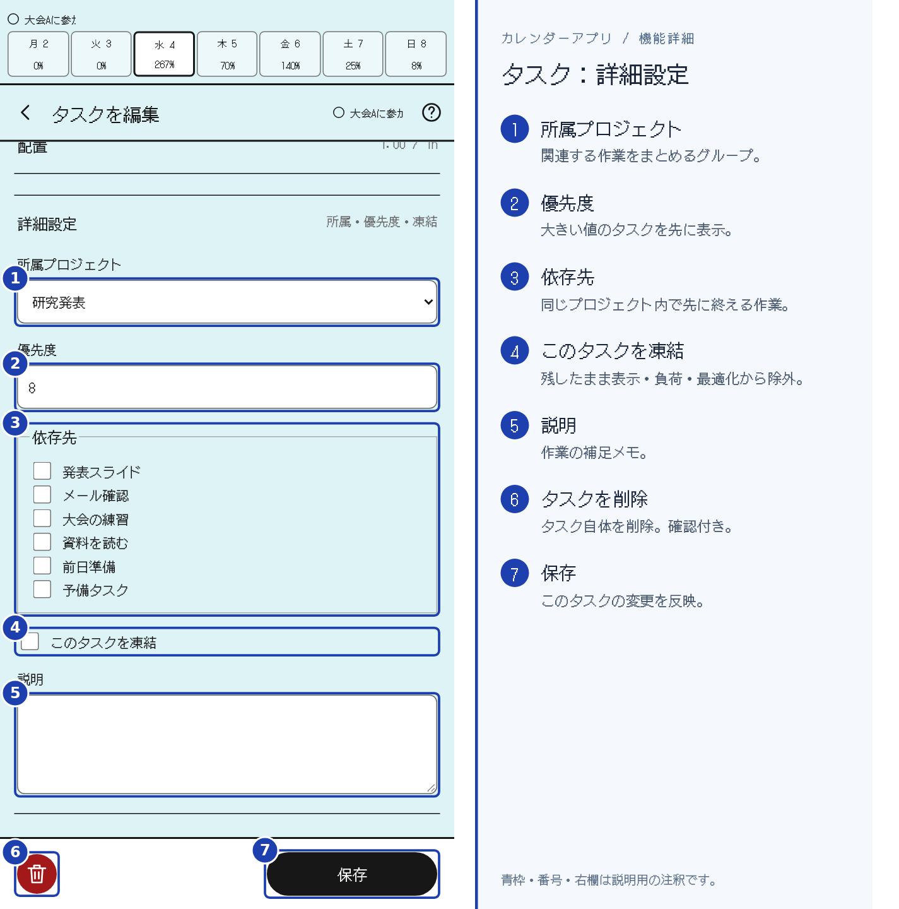

| 番号 | 項目 | 意味 |
|---|---|---|
| 1 | 所属プロジェクト | 関連する作業をまとめるグループです。未所属にもできます。 |
| 2 | 優先度 | 大きい値ほど優先します。カレンダーのタスク名の表示順や最適化の処理順に使います。 |
| 3 | 依存先 | 同じプロジェクト内で、先に終える必要があるタスクを選びます。依存先を設定したタスクは、依存先の完了日の翌日以降に着手する条件になります。 |
| 4 | このタスクを凍結 | タスクを残したまま、カレンダー表示・負荷計算・最適化から外します。解除すると再び対象になります。 |
| 5 | 説明 | 作業の内容や補足メモを記録します。 |
| 6 | タスクを削除 | 既存タスクの編集時に表示します。確認後、タスク自体を削除します。 |
| 7 | 保存 | 入力した変更を反映します。 |

依存先の候補は、所属プロジェクトを選ぶと表示されます。所属プロジェクトを変えると、それまでの依存先は解除されます。

プロジェクト全体が凍結されている場合は、所属タスクも凍結対象です。タスク単体の凍結をオフにしても、プロジェクトの凍結中は対象外のままです。

## 7. プロジェクトと終日予定

メニューの「一覧」→「プロジェクト」で管理します。新規作成は「追加」、既存項目は鉛筆から編集します。

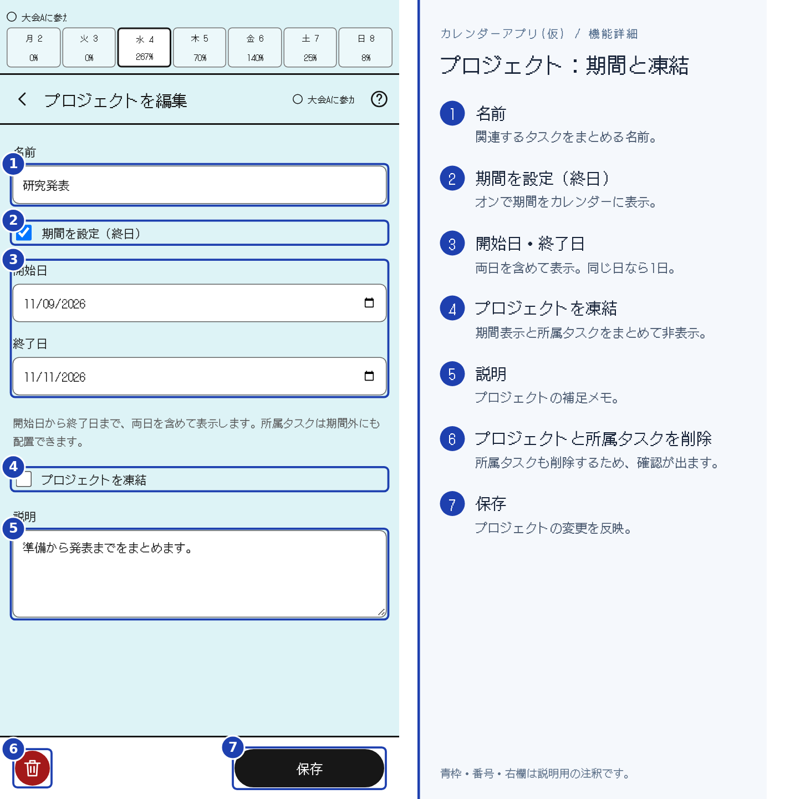

| 番号 | 項目 | 意味 |
|---|---|---|
| 1 | 名前 | プロジェクトを識別する名前です。期間を設定した場合はカレンダーにも表示します。 |
| 2 | 期間を設定（終日） | オンにすると開始日と終了日を設定できます。オフなら、期間のないタスクのグループとして使えます。 |
| 3 | 開始日・終了日 | 両日を含む期間です。同じ日にすると1日だけの終日予定になります。 |
| 4 | プロジェクトを凍結 | カレンダーの期間表示を隠し、所属タスクも表示・負荷計算・最適化から外します。 |
| 5 | 説明 | プロジェクトの補足メモです。 |
| 6 | プロジェクトと所属タスクを削除 | 確認後、所属するタスクも一緒に削除します。プロジェクト名だけを消す操作ではありません。 |
| 7 | 保存 | プロジェクトの変更を反映します。 |

たとえば「大会開催日」「旅行期間」「研究発表」を期間付きプロジェクトとして表示できます。**期間そのものには作業時間・負荷がありません。** 準備や移動などの作業がある場合は、その時間と負荷をタスクとして別に登録してください。

所属タスクをプロジェクト期間内に収める制限はありません。大会前の準備を、開催期間より前に配置してかまいません。所属タスクがなくても期間だけを表示できます。

## 8. 最適化と取り消し

### 8.1 最適化

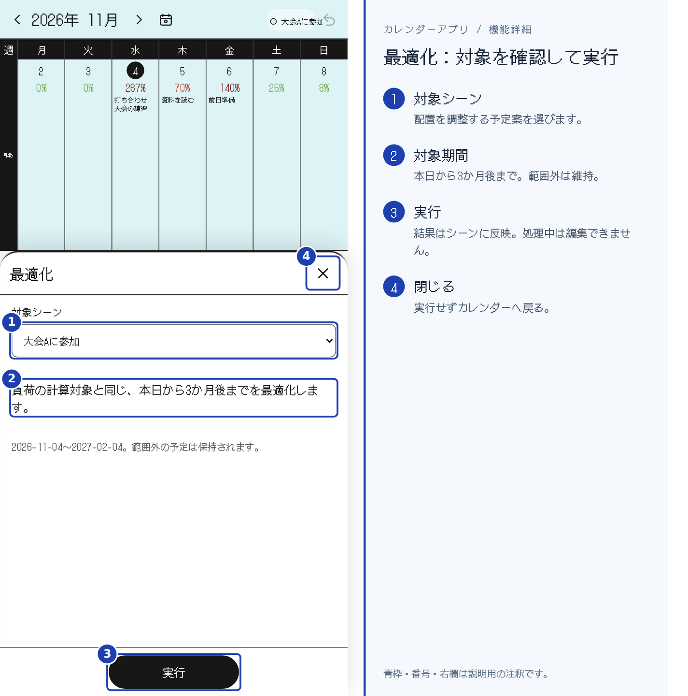

| 番号 | 項目 | 意味 |
|---|---|---|
| 1 | 対象シーン | 配置を調整するシーンを選びます。主シーンを選んだ場合は採用中の予定が変わるため、実行先を確認してください。 |
| 2 | 対象期間 | 負荷計算と同じ、本日から3か月後までです。期間を入力する操作はありません。 |
| 3 | 実行 | 柔軟タスクを負荷や期限、依存関係などに基づいて再配置し、結果をシーンへ反映します。 |
| 4 | × | 実行せずに閉じます。 |

固定・凍結されたタスクと、対象範囲外の配置は維持します。処理中は最適化専用画面になり、編集できません。制約を満たす案を作れなければ、理由を表示し、結果を反映しません。

最適化後も、負荷の超過や固定タスク同士の重複が残る場合があります。結果の日別詳細を確認してください。

### 8.2 Undo（取り消し）

画面右上の**折り返した矢印**から、直前のタスク編集や最適化などを取り消せます。取り消す内容を確認してから実行します。取り消せる操作がなければボタンは無効です。

Undoは編集中の入力を戻すボタンではありません。保存前の編集をやめるときは、編集画面の「戻る」から破棄を選びます。ファイルのロードやデータリセットをUndoで戻すこともできません。

## 9. 設定

### 9.1 設定の入口

メニューの歯車から開きます。

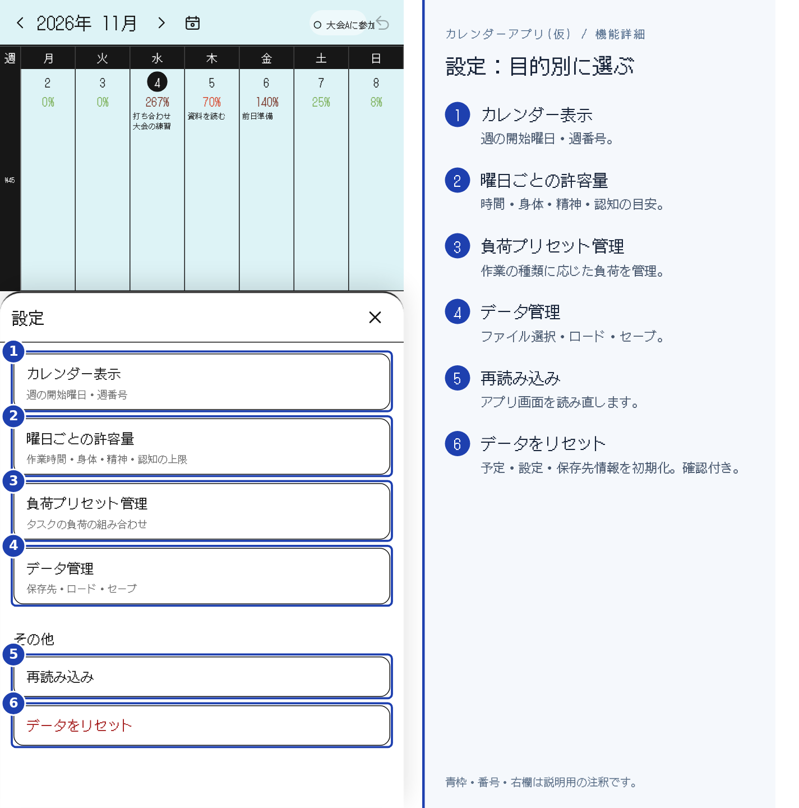

| 番号 | 項目 | 開く内容 |
|---|---|---|
| 1 | カレンダー表示 | 週の開始曜日と週番号の設定。 |
| 2 | 曜日ごとの許容量 | 7曜日それぞれの、時間・身体・精神・認知の目安。 |
| 3 | 負荷プリセット管理 | タスクで選ぶ負荷の組み合わせの追加・編集・削除。 |
| 4 | データ管理 | ファイルの選択、ロード、セーブ、ダウンロードなど。 |
| 5 | 再読み込み | ブラウザでアプリ画面を読み直します。「選択中のファイルをロード」とは別の操作です。 |
| 6 | データをリセット | 予定、設定、プリセット、保存先情報を初期化します。確認後に実行します。外部ファイルは変更しません。 |

### 9.2 カレンダー表示

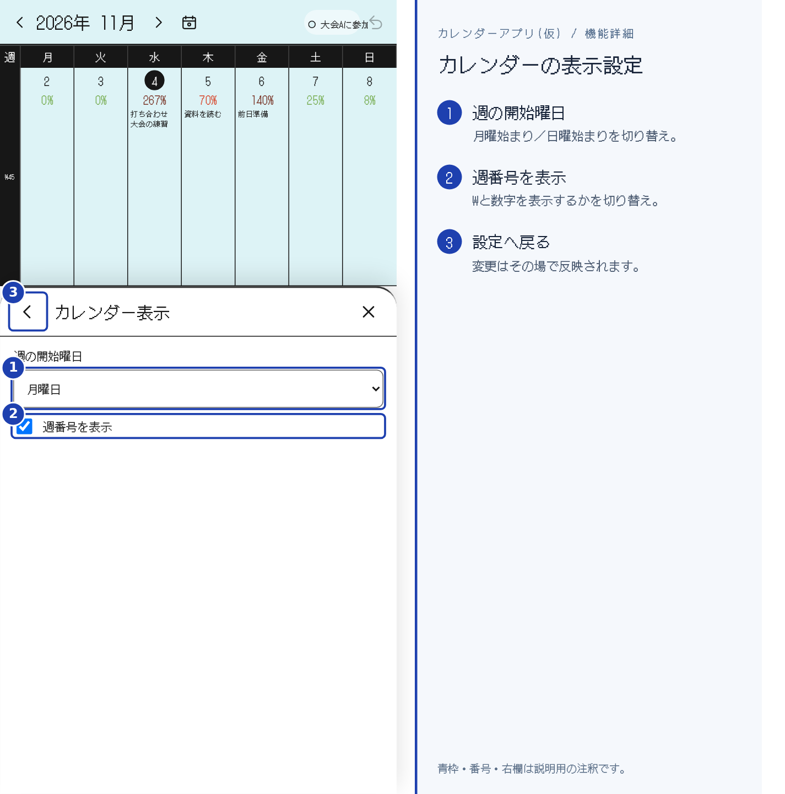

| 番号 | 項目 | 意味 |
|---|---|---|
| 1 | 週の開始曜日 | 左端を月曜日または日曜日にします。 |
| 2 | 週番号を表示 | `W` と数字の列を表示・非表示にします。週番号はISO方式で、開始曜日を変えても方式は変わりません。 |
| 3 | 設定へ戻る | 上の設定メニューへ戻ります。この画面の変更はその場で反映されます。 |

### 9.3 曜日ごとの許容量

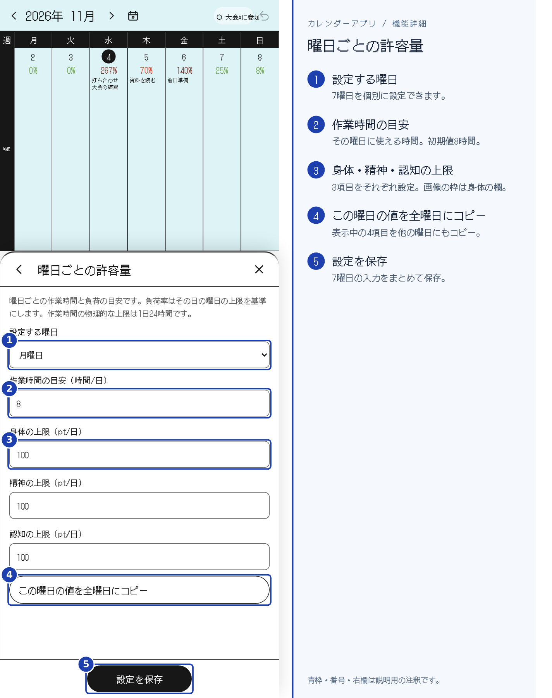

| 番号 | 項目 | 意味 |
|---|---|---|
| 1 | 設定する曜日 | 月〜日の7曜日を切り替えて、個別に入力できます。 |
| 2 | 作業時間の目安 | その曜日に使える1日分の時間です。初期値は8時間です。 |
| 3 | 身体・精神・認知の上限 | 各項目の1日分の目安です。初期値はそれぞれ100ptです。 |
| 4 | この曜日の値を全曜日にコピー | 現在表示中の4項目を、他の曜日にもコピーします。保存するまでは入力内容の変更です。 |
| 5 | 設定を保存 | 7曜日の入力をまとめて保存し、負荷計算に反映します。曜日の切替だけでは確定しません。 |

すべて**0より大きい値**を入力します。休みを表すために上限を0にする設定はありません。休みとして時間を確保する場合はタスクで表します。

許容量はシーンごとの値ではなく、シーンを比較するときの共通の目安です。ある曜日の上限を下げると、同じ作業量でもその曜日の負荷率は高くなります。タスクに設定した作業時間やpt/時間そのものを変更する設定ではありません。

保存前に戻る・閉じる場合、変更があれば破棄確認が出ます。

### 9.4 負荷プリセット管理

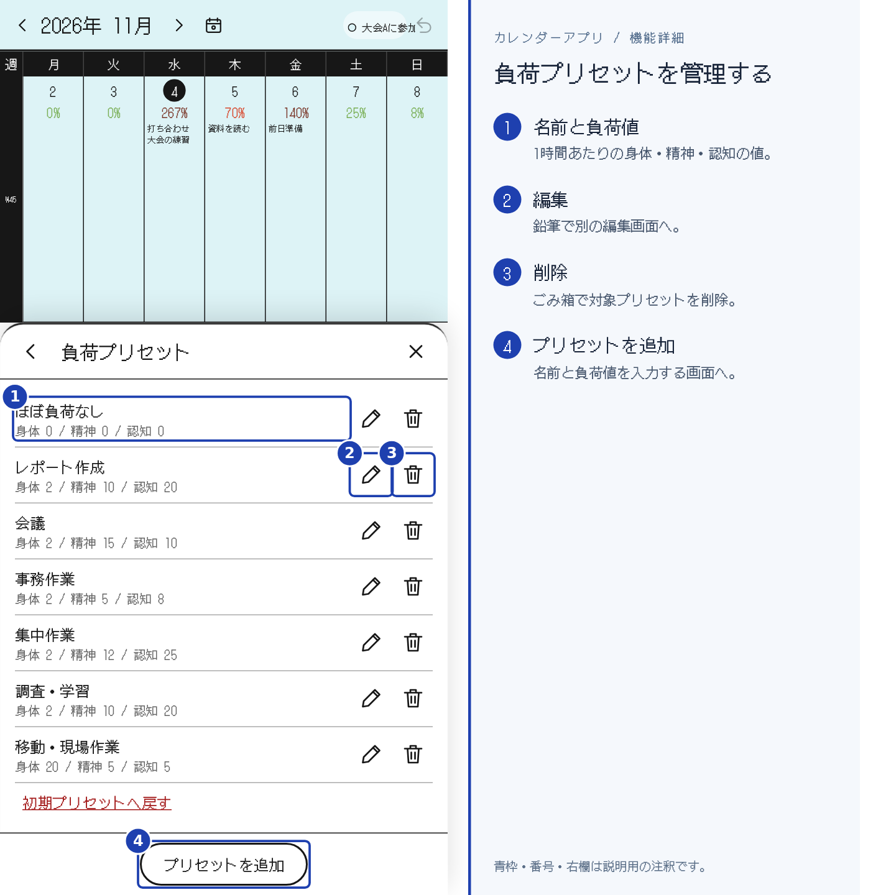

| 番号 | 項目 | 意味 |
|---|---|---|
| 1 | 名前と負荷値 | 身体・精神・認知の1時間あたりの値を表示します。 |
| 2 | 鉛筆：編集 | 名前と負荷を変更する独立した画面を開きます。 |
| 3 | ごみ箱：削除 | 確認後、そのプリセットを一覧から削除します。 |
| 4 | プリセットを追加 | 新しい名前と負荷値を入力する画面を開きます。 |

一覧の下までスクロールすると「初期プリセットへ戻す」があります。確認後、現在の一覧を初期の組み合わせで置き換えます。

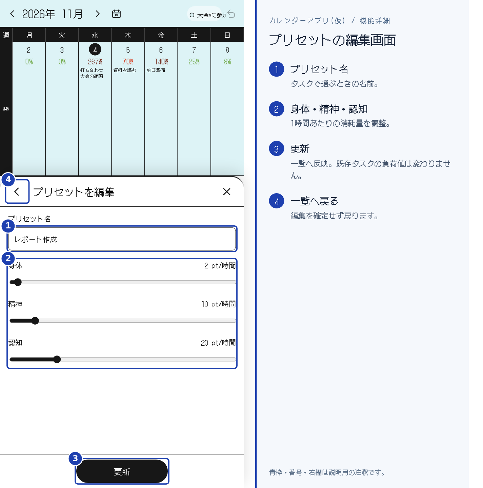

編集画面では、①名前、②身体・精神・認知のスライダーを設定し、③「更新」で確定します。新規作成なら「追加」と表示されます。④左上の戻るボタンは、更新せず一覧へ戻ります。

**プリセットの変更・削除・初期化で、既存タスクの負荷値は変更されません。** タスクへ反映したいときは、そのタスクの編集画面でプリセットを選び直して保存してください。プリセット一覧もファイルの保存・ロード対象です。

## 10. 保存とデータ管理

### 10.1 ブラウザ内とファイルの関係

**編集中の作業内容は、どちらの方式でもブラウザ内に保持します。** ファイルを選択すると、その内容をロードしたり、現在の作業内容をそのファイルにセーブしたりできるようになります。別の端末やブラウザへ自動的に共有する機能ではありません。

ファイルにはシーン、タスク、プロジェクト、カレンダー設定、曜日ごとの許容量、負荷プリセットを保存します。別の端末へ移す場合は、そのファイルをコピーし、移動先のアプリで選択してロードします。

### 10.2 ブラウザ内で作業するとき

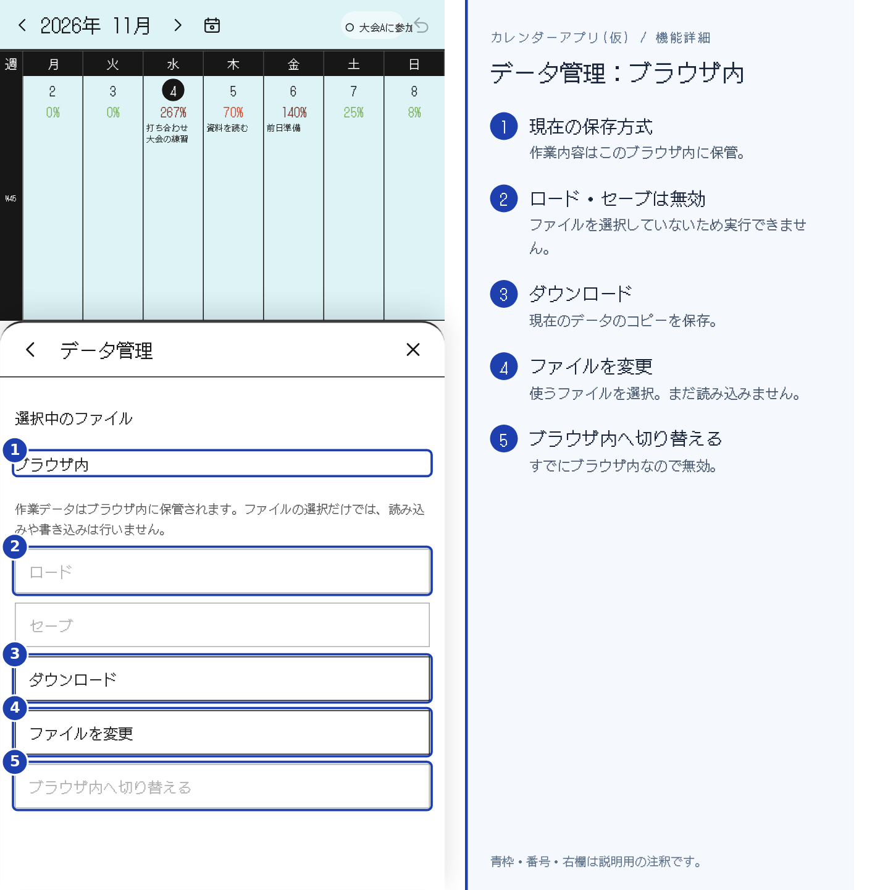

| 番号 | ボタン・表示 | 動作 |
|---|---|---|
| 1 | ブラウザ内 | ファイルを選択していない状態です。作業内容はこのブラウザ内に保存されます。 |
| 2 | ロード・セーブ | ファイルを選択していないため無効です。 |
| 3 | ダウンロード | 現在の内容のコピーをファイルとしてダウンロードします。選択中のファイルは作らず、ブラウザ内での作業を続けます。 |
| 4 | ファイルを変更 | ファイル選択画面を開き、使用するファイルを選びます。選んだだけでは読み込みません。 |
| 5 | ブラウザ内へ切り替える | すでにブラウザ内のため無効です。 |

初めてファイルを使う場合は、まず「ダウンロード」で作ったファイルを「ファイルを変更」から選択できます。選択後、**そのファイルの中身を使うならロード、現在の作業内容を書き込むならセーブ**を押します。

### 10.3 ファイルを選択して作業するとき

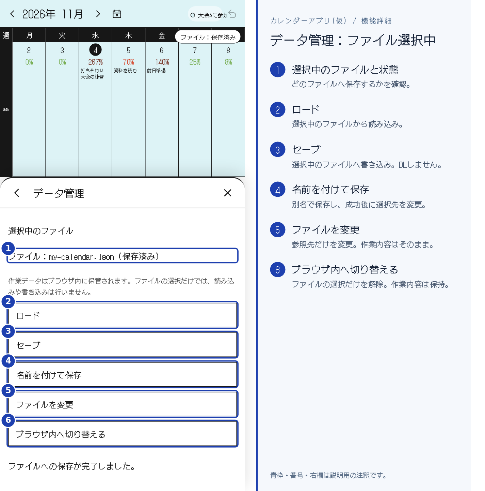

| 番号 | ボタン | 動作と注意点 |
|---|---|---|
| 1 | ファイル名・保存状態 | 読み書きする対象と、未保存や競合の有無を確認します。 |
| 2 | ロード | **選択中のファイルだけ**を読みます。選択画面は開きません。未保存なら上書き確認、保存済みならそのまま実行します。 |
| 3 | セーブ | **選択中のファイルだけ**へ現在の作業内容を書きます。必要ならアクセス許可を求めます。失敗したらエラーを表示し、ダウンロードに切り替えません。 |
| 4 | 名前を付けて保存 | 保存先を指定して別名で保存し、成功後にそのファイルを新しい選択先にします。キャンセル・失敗なら元の選択先を維持します。 |
| 5 | ファイルを変更 | 選択先だけを変更します。現在のシーンや設定を入れ替えず、ファイルへも書き込みません。 |
| 6 | ブラウザ内へ切り替える | ファイルの選択だけを解除します。作業内容は保持します。元ファイルは更新しません。 |

「名前を付けて保存」は、ブラウザ内モードでは同じ位置の「ダウンロード」に変わります。

ファイル選択の直後は「選択変更済み・未同期」です。**ロードまたはセーブが成功するまで、そのファイルへの自動保存は停止します。** 選択前に未保存の編集があれば、その編集も保持されます。

同期後は、直接保存に対応したブラウザで、アクセスが許可されていれば変更を自動保存します。「保存済み」になったことを確認してください。権限を要求された場合は「セーブ」を押して許可できます。

直接ファイル操作への対応はブラウザや利用環境によって異なります。対応しない環境では、その操作をエラーとして知らせます。ブラウザ内保存と「ダウンロード」は利用できます。

### 10.4 未保存のままロードする場合

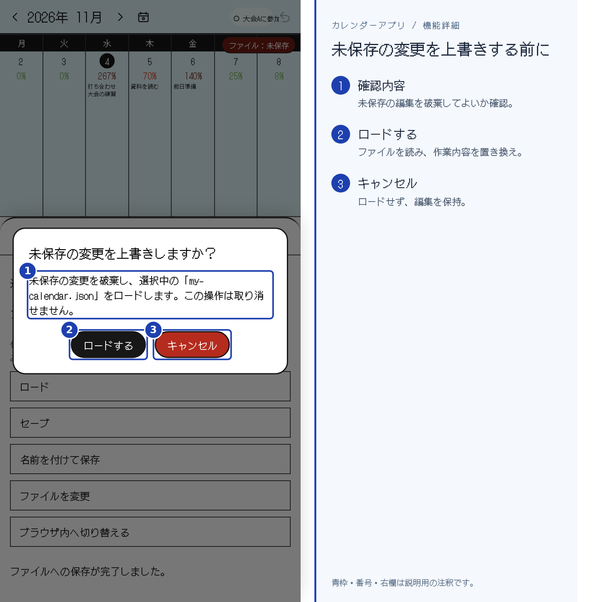

未保存の変更がある場合だけ確認します。

- **②ロードする**：未保存の編集を破棄し、選択中のファイルで作業内容を置き換えます。Undoでは戻せません。
- **③キャンセル**：ロードせず、編集中の内容を保持します。

確認中は自動保存も停止します。ロードの読取り・検証に失敗した場合は、承認済みでも作業内容を置き換えません。

### 10.5 保存状態の意味

上部にある保存状態のボタンを押すと、データ管理を直接開けます。

| 表示 | 意味・次にすること |
|---|---|
| 保存済み | 現在の作業内容を選択中のファイルへ反映したことを確認できています。 |
| 保存中… | ファイルへの書き込み中です。 |
| 未保存 | 作業内容のうち、ファイルへ反映されていない変更があります。「セーブ」で明示的に保存できます。 |
| 選択変更済み・未同期 | ファイルを選び直した直後です。ロードまたはセーブで、どちらの内容を使うか決めます。 |
| 保存エラー | ファイル操作が失敗しました。エラーダイアログの内容を確認します。 |
| アクセス許可待ち | ファイルへのアクセスが許可されていません。「セーブ」などの操作で許可を求めます。 |
| 競合あり | 選択中のファイルが外部で変更されました。自動保存を停止しています。 |
| 保存先を再選択／ファイル参照なし | 保存先への参照がありません。作業内容を確認してファイルを選び直します。 |
| ダウンロード開始 | コピーのダウンロードを開始しました。元ファイルへセーブしたという意味ではありません。 |

### 10.6 外部編集との競合

ファイルを他のアプリで変更すると、「競合あり」として自動保存を停止します。アプリを閉じる前に未保存だった編集があっても、再起動時に外部ファイルで勝手に置き換えることはありません。

| 残したい内容 | 操作 |
|---|---|
| 外部で編集したファイル | 「ロード」を押します。アプリ側に未保存の編集があれば、破棄してよいか確認します。 |
| アプリで編集中の内容 | 「セーブ」では上書きを止めます。外部の変更を捨ててよいときだけ「外部ファイルを上書きする」を選び、確認して実行します。 |
| 両方の内容 | 「名前を付けて保存」でアプリ側の内容を別ファイルへ保存し、外部で変更した元ファイルも残します。 |

外部ファイルを上書きする確認後に、さらに外部で変更された場合は再び処理を止めます。エラーを閉じるだけでは競合は解除されません。

### 10.7 複数タブで開いた場合

タブ間の編集制限に対応する環境では、先に開いたタブが編集用、後から開いたタブは読み取り専用になります。読み取り専用のタブを編集に使いたい場合は、元の編集タブを閉じてから再読み込みします。

ブラウザ内に保存したデータは、そのブラウザのサイトデータを削除すると失われます。別端末への移動や手元にコピーを残すときは、ファイル保存・ダウンロードを利用してください。

## 11. 確認・警告・エラー

### 11.1 確認画面

削除、主シーンへの反映、Undo、編集の破棄、リセットなど、内容を失う操作では確認画面が出ます。左側のボタンが実行、**右側の赤い「キャンセル」が中止**です。

タスク・プロジェクトの編集で入力を変えていなければ、「戻る」で破棄確認は出ません。

### 11.2 警告画面

入力や配置に注意点があると、警告内容と未確認件数を表示します。

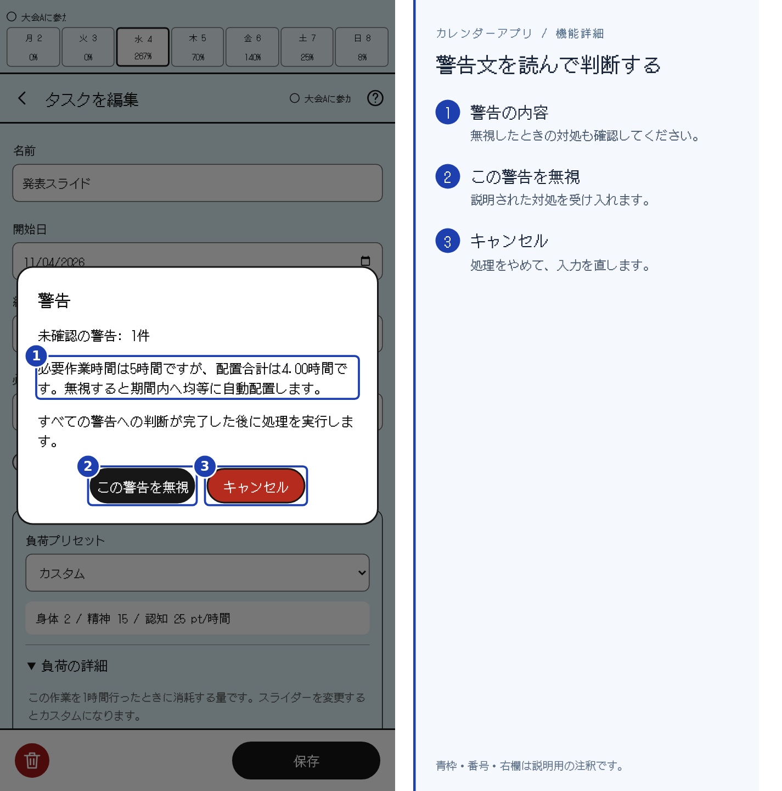

| ボタン・表示 | 意味 |
|---|---|
| この警告を無視 | 無視できる警告について、説明された対処を受け入れて進みます。すべての警告の判断後に処理を実行します。 |
| 無視できない警告 | 「この警告を無視」が無効です。キャンセルし、入力を直してください。 |
| キャンセル | 処理を中止します。入力を修正してやり直せます。 |

警告を無視すると、内容が調整される場合があります。たとえば配置合計の不一致では均等配置に変わり、依存関係の警告では該当の依存を解除します。**警告文を読んでから判断してください。**

### 11.3 操作エラー

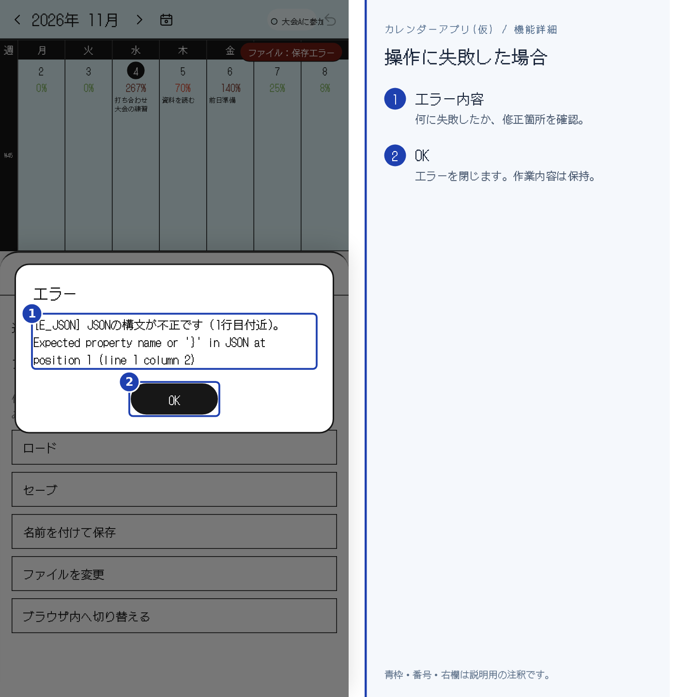

①には失敗の理由を表示します。保存ファイルの不正であれば、エラーコード、行番号や問題の説明が含まれる場合があります。②「OK」、またはEscキーで閉じます。エラーは画面の下に流れる通知ではなく、ダイアログで確認します。

ロードやセーブに失敗しても、作業内容は保持します。エラーを閉じただけで保存成功にはなりません。権限、選択先、ファイル内容など、表示された理由を解消してから操作をやり直してください。

データを読み込めないときの「リセット」は、原因を直す操作ではなく**アプリ内の予定と設定を消す操作**です。実行前に確認内容を読んでください。
