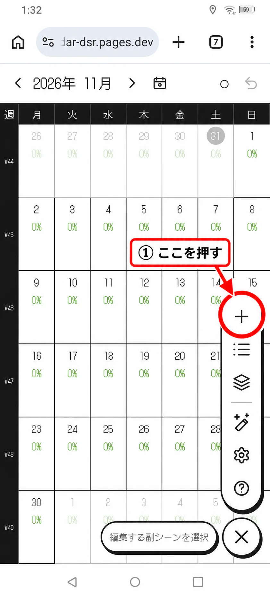
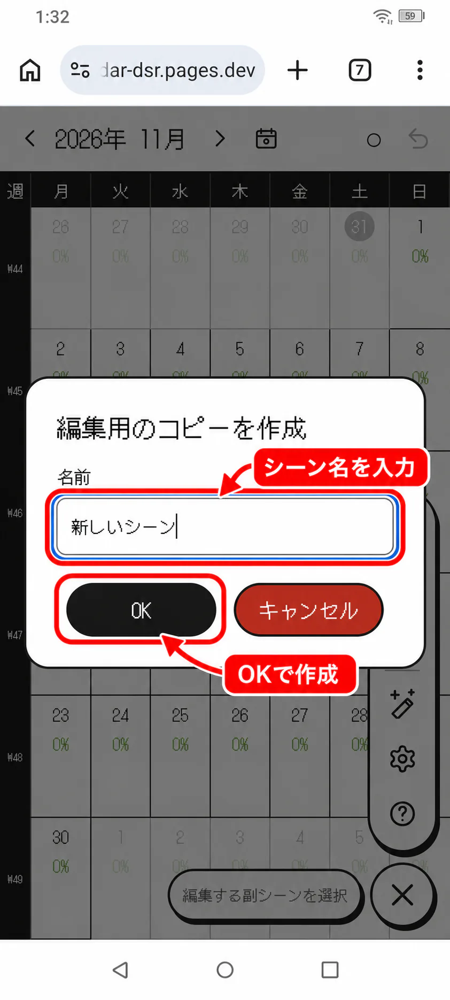
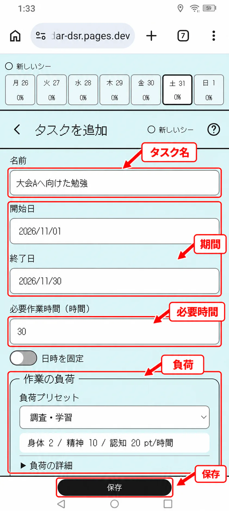
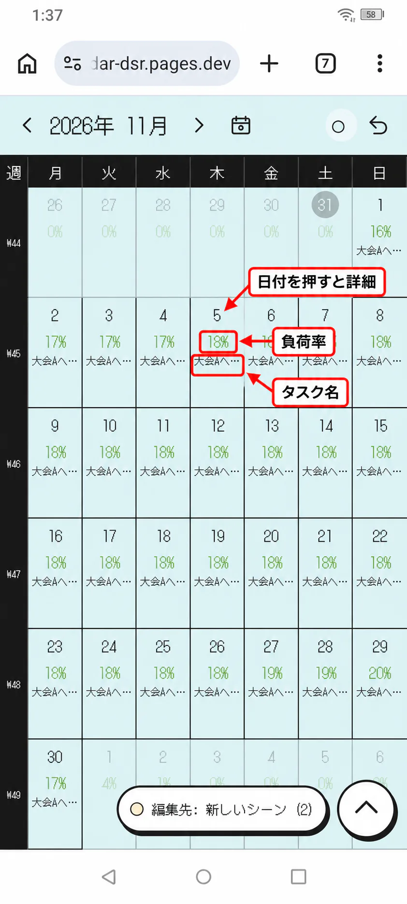
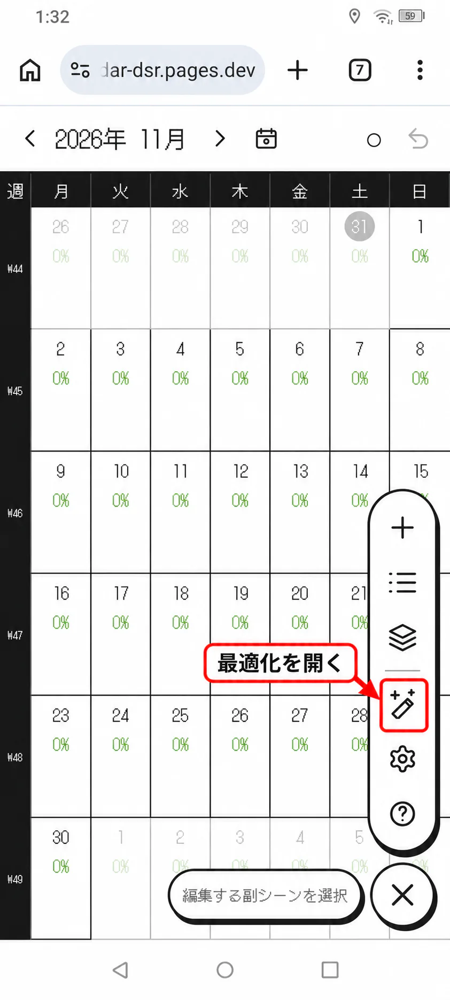
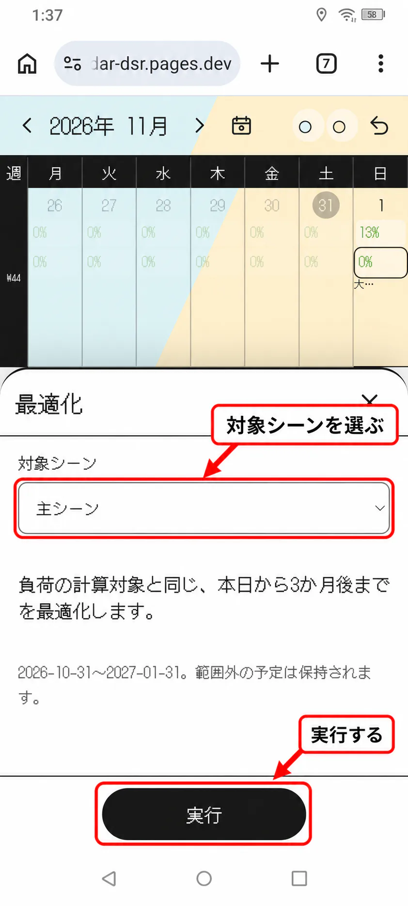
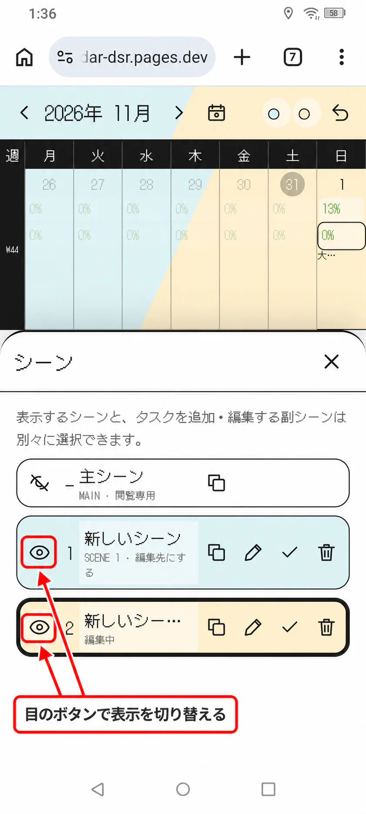
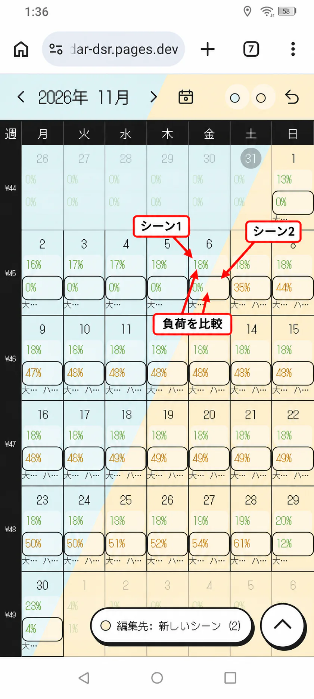
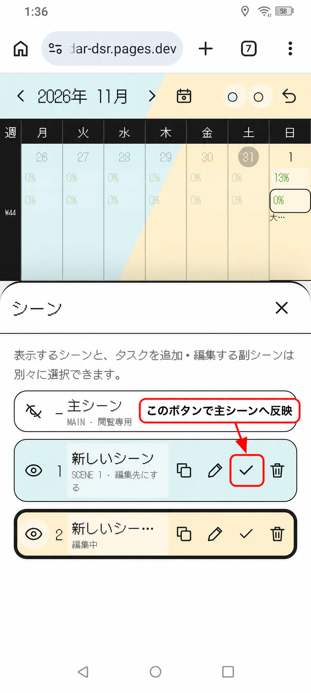
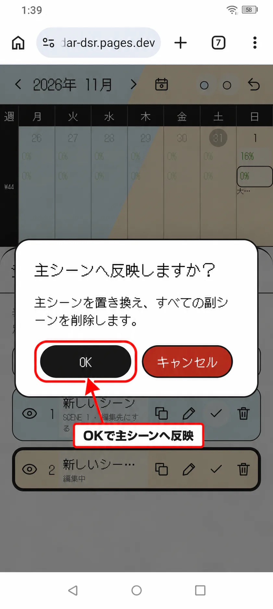

# カレンダーアプリ(仮) 利用ガイド

このガイドでは、予定案を作成し、タスクを登録して、主シーンへ反映するまでの基本的な流れを説明します。

## 利用の流れ

1. 副シーンを作成する
2. タスクを登録する
3. カレンダーで予定と負荷を確認する
4. 必要に応じて最適化する
5. 必要に応じて別のシーンと比較する
6. 採用する副シーンを主シーンへ反映する

## 1. 副シーンを作成する

予定を変更するときは、主シーンを直接編集せず、副シーンを作成します。

画面の「＋」を選択します。

副シーンがまだない場合は、編集用のコピーを作成する画面が表示されます。

作成する副シーンの名前を入力してください。例えば、大会へ参加する場合の予定を検討するなら、「大会Aへ参加」のような名前を付けます。

「OK」を選択すると、現在の主シーンを元に副シーンが作成され、タスク追加画面が開きます。

## 2. タスクを登録する

タスク追加画面で、予定へ追加する作業を入力します。

最低限、次の項目を設定します。

- タスク名
- 配置可能期間
- 必要作業時間
- 負荷
- 配置方法

入力後に「保存」を選択すると、タスクが副シーンへ追加されます。

続けてタスクを追加する場合は、もう一度画面の「＋」を選択します。

新しいタスクは、画面下の「編集先」に表示されている副シーンへ追加されます。

## 3. 予定と負荷を確認する

タスクを保存すると、カレンダーにタスク名と負荷率が表示されます。

日付を選択すると、その日に配置されたタスクと、時間・身体・精神・認知の負荷を確認できます。

負荷が特定の日へ集中している場合は、タスクの期間や配置を変更します。

## 4. 最適化する

タスクの配置を調整したい場合は、メニューから「最適化」を開きます。

最適化する対象シーンを選択し、「実行」を選びます。

実行すると、移動可能なタスクが負荷、期限、依存関係に基づいて再配置されます。

固定タスク、凍結されたタスク、最適化範囲外の配置は維持されます。結果を戻したい場合はUndoを使用します。

## 5. シーンを比較する

別の予定案を試す場合は、シーンを複製するか、主シーンから新しい副シーンを作成します。

「シーン」を開き、目のボタンで比較したい2つのシーンを表示対象にします。

2つのシーンを表示すると、カレンダーがシーンごとに色分けされ、日ごとの負荷とタスクの違いを比較できます。

例えば「大会Aへ参加」と「ハッカソンBへ参加」を表示し、どちらの予定が実行しやすいかを確認します。

## 6. 主シーンへ反映する

採用する予定案が決まったら「シーン」を開き、対象となる副シーンのチェックボタンを選択します。

確認画面には、主シーンが置き換わり、他の副シーンが削除されることが表示されます。

内容を確認して「OK」を選択してください。

これで、検討した予定案が現在の予定として採用されます。
